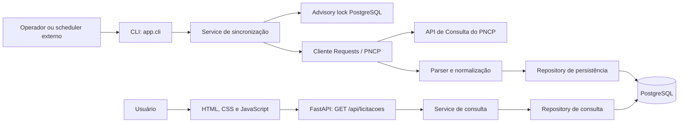

# Auditoria técnica do NEXUS

**Revisão auditada:** `origin/main` em `3426889` (merge do PR 20)  
**Data da auditoria:** 1 de novembro de 2026  
**Escopo:** implementação, dados, API, interface, PostgreSQL, testes, CI e segurança.  
**Objetivo:** registrar o que o código faz, por que as escolhas atuais são adequadas ao estágio do sistema e quais limites ainda existem.

> Esta documentação descreve evidências do repositório e medições efetivamente realizadas. Recomendações e interpretações estão identificadas como tais. Tecnologias apenas planejadas não são apresentadas como implementadas.

## 1. Resumo executivo

O NEXUS é um monólito pequeno que coleta contratações do PNCP por uma CLI, transforma os registros recebidos, persiste os dados no PostgreSQL e os disponibiliza por uma API FastAPI e um frontend estático em HTML, CSS e JavaScript.

As decisões técnicas mais relevantes observadas são:

- separar a coleta externa do caminho de consulta HTTP, para que a tela consulte dados persistidos mesmo quando o PNCP está indisponível;
- usar `numeroControlePNCP` como chave de negócio única e fazer upsert idempotente;
- conservar campos normalizados para consulta e o payload original em JSONB para rastreabilidade;
- confirmar cada página junto com seu checkpoint, permitindo retomada depois de falhas;
- limitar tempo, tentativas, páginas, tamanho de resposta e entradas da API;
- testar o backend com PostgreSQL descartável na CI.

O sistema é funcional para ingestão e consulta de oportunidades. Não há evidência de microsserviços, plataforma de dados distribuída, scheduler embutido, containerização ou deploy automatizado. A coleta continua síncrona e operacional via CLI.

## 2. Como a auditoria foi realizada

Foram inspecionados os arquivos da `main` no commit `3426889`, o histórico recente, os testes, a migration, o workflow do GitHub Actions e o banco PostgreSQL configurado no ambiente, sempre com consultas somente leitura para a análise de desempenho.

Validações e evidências disponíveis:

- a execução de CI associada à merge do PR 20 terminou com sucesso em Python 3.10 e 3.14: [workflow run](https://github.com/gdracojj/nexus/actions/runs/41260562870);
- a suíte local parcial executada na task de segurança teve 87 testes aprovados e 1 ignorado por falta de `tzdata` naquele ambiente;
- o banco respondeu na revisão Alembic `0001_initial_persistence` e, na medição de 31/10/2026, continha 2.139 licitações, 2.139 payloads e 33 execuções;
- medições SQL foram feitas com `EXPLAIN (ANALYZE, BUFFERS)` em transação PostgreSQL somente leitura;
- não foi calculado percentual de cobertura, pois o projeto não configura ferramenta de coverage.

Os números do banco e os tempos abaixo representam uma amostra de ambiente e data específicos; não são metas, garantias ou resultados de benchmark de carga.

## 3. Arquitetura real e fluxo ponta a ponta

### 3.1 Coleta

1. O operador chama `python -m app.cli coletar --uf RJ` ou outra UF.
2. O service gera parâmetros para a UF, período atual até sete dias depois e modalidade `6`.
3. O repository adquire um advisory lock global no PostgreSQL. Ele impede duas coletas simultâneas do Nexus, inclusive para UFs diferentes.
4. O cliente consulta o endpoint fixo `https://pncp.gov.br/api/consulta/v1/contratacoes/proposta`, segue `totalPaginas`, valida a resposta e normaliza uma página por vez.
5. O repository faz upsert das licitações e atualiza o checkpoint na mesma transação da página.
6. Ao terminar, a execução fica `concluida`; após uma falha com páginas confirmadas, fica `parcial` e pode ser retomada.

### 3.2 Consulta

1. O navegador chama `GET /api/licitacoes` na mesma origem.
2. FastAPI valida os parâmetros e o service encaminha a consulta ao repository.
3. O PostgreSQL filtra e pagina dados já persistidos.
4. A API devolve itens, totais, metadados de paginação, última sincronização concluída e resumo da tentativa mais recente.
5. O cliente JavaScript normaliza a resposta e renderiza as visões da interface.

A consulta não acessa o PNCP. Isso reduz a dependência da disponibilidade externa durante o uso do painel, ao custo de depender da atualização operacional da base.

## 4. Tecnologias e motivos da escolha observável

| Tecnologia | Uso no NEXUS | Motivo técnico no contexto atual | Situação e limite |
|---|---|---|---|
| Python 3.10+ | integração, parsing, CLI, API e persistência | linguagem única para orquestrar HTTP, validação e banco sem separar workers | Implementado; a CI testa Python 3.10 e 3.14 |
| FastAPI | rota REST e documentação OpenAPI gerada | valida query parameters e fornece uma API HTTP simples integrada ao ASGI | Implementado; saída ainda é dicionário, sem `response_model` explícito |
| Uvicorn | servidor ASGI para executar FastAPI | necessário para servir a aplicação FastAPI no modo ASGI | Dependência declarada; deploy específico não está no repositório |
| Requests | chamadas síncronas ao PNCP | combina com coleta em CLI bloqueante; não exige arquitetura async para este fluxo | Implementado; não usa `requests.Session` para compartilhar conexões entre páginas |
| PostgreSQL | persistência principal | oferece transações, constraints, JSONB e advisory locks usados pelo código | Implementado; usuário, TLS, backup e privilégios são configuração externa |
| SQLAlchemy 2 | engine, sessões, ORM, consultas e upsert PostgreSQL | centraliza acesso parametrizado e mapeamento relacional; permite SQL PostgreSQL específico quando necessário | Implementado; repository ainda agrega mais de uma responsabilidade |
| psycopg2-binary | driver DBAPI PostgreSQL | conecta SQLAlchemy ao protocolo PostgreSQL sem exigir compilação local do driver | Implementado como dependência runtime |
| Alembic | migrations de schema | mantém alterações do banco versionadas e repetíveis sem criar tabelas implicitamente no startup | Implementado; há uma migration inicial |
| JSONB | payload PNCP original e parâmetros da execução | preserva a estrutura externa variável sem perder campos não projetados para colunas | Implementado; guarda o snapshot atual, não histórico de versões |
| `Decimal` + `NUMERIC(20,4)` | valor estimado | mantém representação decimal apropriada a valores monetários sem depender de aritmética binária de `float` | Implementado |
| `zoneinfo` / `tzdata` | datas sem offset e visualização de prazo | interpreta datas civis no fuso `America/Sao_Paulo` e mantém regras de fuso explícitas | Implementado; `tzdata` é fallback de regras quando o host não fornece a base |
| `hashlib.sha256` | hash do payload | detecta mudança do JSON normalizado e evita atualizar snapshot idêntico | Implementado; não é assinatura de autenticidade |
| `argparse` | interface de linha de comando | fornece subcomando e validação sintática simples sem framework CLI adicional | Implementado em `app/cli.py` |
| Pytest | testes unitários, HTTP e banco | permite testar parser, retries, API e persistência com fixtures e doubles | Implementado; cobertura percentual não configurada |
| `httpx2` | transporte usado por `TestClient` | fornece a dependência compatível com o cliente de teste usado para exercitar rotas FastAPI | Dependência de teste; não é usada pelo cliente PNCP em runtime |
| PostgreSQL 16 no GitHub Actions | serviço isolado para integração | exercita migrations, constraints, transações e consultas em um banco real descartável | Implementado na CI; não é o banco de produção/desenvolvimento |
| GitHub Actions | validação de pull requests e `main` | automatiza instalação, `pip check`, testes backend e sintaxe JS | CI implementada; não há CD, publicação ou deploy |
| `pip-audit` action | auditoria de dependências Python | verifica advisories conhecidos nos requirements sem atualizar versões automaticamente | Implementado na CI; não substitui revisão de código ou análise dinâmica |
| HTML/CSS/JavaScript ES modules | interface e cliente HTTP | atende uma interface de poucas telas sem build, runtime ou framework adicional | Implementado; testes automatizados de frontend ainda são limitados |
| `python-dotenv` | leitura local de configuração | facilita executar localmente com `.env`, mantendo configuração fora do código | Implementado; `.env` está ignorado pelo Git |
| `tzdata` | regras de fuso horário | permite interpretar datas civis sem offset com fuso de negócio explícito, inclusive em ambientes sem base de fusos do sistema | Dependência declarada; um teste local foi ignorado quando não estava instalada |
| `urllib3`, `certifi`, `idna`, `charset-normalizer` | dependências transitivas fixadas de Requests | fornecem transporte HTTP, certificados raiz, suporte a nomes internacionalizados e decodificação de charset | Fixadas em `requirements.txt`; não são APIs chamadas diretamente pelo domínio |

Não foram encontrados Docker, Docker Compose, Kubernetes, cloud provider configurado, Airflow, dbt, Kafka, Redis, Celery, React, TypeScript no frontend do NEXUS, data lake ou warehouse.

## 5. Engenharia de dados: extração, transformação e carga

### 5.1 Extração e limites

`app/pncp/client.py` usa um único endpoint do PNCP e envia `uf`, `codigoModalidadeContratacao=6`, `dataInicial`, `dataFinal` e página. A janela usa a data do relógio local do processo e vai até sete dias depois.

Os limites atuais são:

- timeout por requisição de até 30 segundos, reduzido ao prazo restante;
- prazo total configurado de 300 segundos por execução;
- até 5 tentativas para timeout, falha de conexão e códigos HTTP transitórios `408`, `429`, `500`, `502`, `503` e `504`;
- backoff exponencial quando não há `Retry-After` válido;
- leitura de `Retry-After` como segundos ou data HTTP, com limite de espera de 60 segundos;
- espera de 1 segundo entre páginas;
- máximo de 110 páginas por UF, exceto SP, com 160 páginas.

Esses limites reduzem loops e duração ilimitados, protegem o processo de coleta e respeitam sinais de rate limit. Requests limita inatividade de conexão; o código não implementa um limite absoluto para uma resposta que continue transmitindo dados continuamente. A coleta é síncrona no processo CLI.

### 5.2 Transformação e validação

O parser valida os objetos PNCP antes de persistir. Campos essenciais incluem número da compra, objeto, unidade/UF e, para persistência, `numeroControlePNCP`. Os dados são aparados e normalizados, a UF é convertida para maiúscula, modalidade/ano são inteiros, valores monetários viram `Decimal` e datas ISO viram objetos `datetime`.

Datas sem offset são interpretadas com `America/Sao_Paulo`. Campos opcionais ausentes ou nulos são aceitos quando esperado; tipos incompatíveis e campos obrigatórios inválidos geram erro explícito. Um registro inválido impede confirmar a página inteira; não existe quarentena por registro.

### 5.3 Classificação ETL/ELT

O fluxo é **ETL por página**: extrai do PNCP, transforma/valida antes de gravar e carrega no PostgreSQL. Ele também guarda o JSON de origem em JSONB, o que é útil para rastreabilidade e futura retransformação.

Não é ELT completo: não existe camada raw/staging separada nem pipeline posterior de transformação dentro do banco. Também não há ferramenta de orquestração ou warehouse. A coleta incremental significa upsert das oportunidades encontradas e checkpoints por página, não CDC nem substituição completa do catálogo.

### 5.4 Persistência idempotente e recuperação

`numeroControlePNCP` é a chave externa única. O upsert evita duplicar a mesma contratação em novas coletas. Duplicatas dentro de cada página são consolidadas antes da gravação. SHA-256 do JSON evita atualizar o payload guardado quando o conteúdo não mudou.

Cada página é deduplicada e gravada em sublotes de até 250 registros por instrução de upsert; esse teto limita o tamanho de cada comando SQL e é configuração fixa, não um valor calibrado por benchmark. O processo confirma cada página em uma transação que inclui dados e checkpoint. A retomada procura execução mais recente com endpoint e mesmos parâmetros, avança para `paginas_consultadas + 1` e continua usando a mesma chave idempotente. Isso preserva progresso confirmado, mas não cria um snapshot imutável: páginas do PNCP podem mudar entre tentativas. Uma execução que permaneça `executando` após encerramento abrupto do processo não é marcada automaticamente como interrompida; pode ser retomada quando os parâmetros coincidirem. Como as datas de consulta mudam diariamente, a execução abandonada pode deixar de coincidir com os parâmetros de uma nova tentativa.

O cache de coleta recente tem padrão de 900 segundos e pode ser configurado por `PNCP_SYNC_CACHE_TTL_SECONDS` de 0 a 86400; zero desativa o reuso. O advisory lock é global, logo somente uma coleta, mesmo de outra UF, pode rodar ao mesmo tempo.

## 6. Modelo PostgreSQL e gerenciamento de conexão

### 6.1 Tabelas

| Tabela | Conteúdo | Restrições e motivo |
|---|---|---|
| `licitacoes` | campos normalizados e consultáveis | PK `id`; `numero_controle_pncp` único; FK da execução; datas com timezone; valor `NUMERIC(20,4)` |
| `pncp_payloads` | JSONB, SHA-256 e horário de recebimento | PK/FK `licitacao_id`, que cria relação um-para-um e impede payload duplicado por licitação; cascade delete |
| `sync_execucoes` | parâmetros, status, timestamps, páginas, contagens e tipo da falha | JSONB para parâmetros/resumo; constraints limitam status e contadores negativos |

O campo `coletada_em` preserva a primeira coleta conhecida; `atualizada_em` acompanha atualizações. `ultima_execucao_id` associa uma licitação à execução que a atualizou por último. O payload é um snapshot atual, não um histórico imutável de cada alteração.

### 6.2 Transações e conexões

SQLAlchemy cria engine cacheado com `pool_pre_ping`, pool de 5 conexões, overflow de até 10 e timeout de 30 segundos. O `pool_pre_ping` verifica conexões reutilizadas antes de entregá-las ao código. Cada worker/processo tem seu próprio pool; portanto, esses números se multiplicam em uma implantação com vários workers. Os limites do pool são configurações fixas, não resultados de dimensionamento por carga medida.

Sessões SQLAlchemy são contextuais e operações de persistência fazem commit/rollback explícito. O advisory lock usa uma conexão PostgreSQL dedicada durante a coleta. Alembic aplica o schema por comando operacional; a aplicação não cria tabelas ao iniciar.

### 6.3 Índices e justificativa de não otimizar por suposição

Foram encontrados os índices inerentes às PKs e à constraint única do identificador. Não há índices explícitos em `uf`, prazo, descrição ou JSONB de parâmetros. Índice custa espaço e trabalho em cada escrita; sua criação foi deixada para quando o plano de execução demonstrar benefício.

## 7. API, consulta e filtros

O endpoint implementado é `GET /api/licitacoes`; não há rota de escrita. O FastAPI valida:

- `uf`: normalizada para maiúsculas e conferida contra as UFs oficiais;
- `produto`: até 100 caracteres, aparado e convertido para minúscula;
- `page`: de 1 a 10.000;
- `page_size`: de 1 a 100, padrão 25;
- `prazo_dias`: de 1 a 30.

O repository exclui prazos vencidos e mantém registros sem data quando não há `prazo_dias`. Quando o filtro de prazo é fornecido, a comparação com o limite futuro também exclui prazos nulos. Produto aplica busca textual case-insensitive na descrição, com escaping. A ordenação é por data de encerramento crescente, datas nulas no fim, e número.

`total_consultado` é contado antes do termo de produto; `total` aplica todos os filtros. A resposta inclui itens, página, tamanho, total de páginas, última sincronização bem-sucedida e resumo da tentativa mais recente. As contagens independentes dão números úteis à interface, mas acrescentam consultas ao banco.

FastAPI gera OpenAPI e Swagger/ReDoc padrão. Não há `response_model` ou schemas Pydantic explícitos para a resposta. Entradas são validadas pelos parâmetros de rota e verificações manuais.

## 8. Frontend e apresentação

O frontend é servido como arquivos estáticos pelo próprio FastAPI. `frontend/api.js` serializa filtros com `URLSearchParams`, usa `fetch`, timeout de 15 segundos e `AbortController` para cancelar buscas substituídas. Também verifica status HTTP, tipo JSON e estrutura mínima da resposta.

`app.js` mantém estado da tela, filtros, paginação e estado da sincronização. As visões incluem tabela, timeline e quadro; a página geral calcula métricas e distribuição por UF a partir dos itens atualmente carregados. `prazo.js` centraliza parsing e classificação temporal no fuso de São Paulo. `theme.js` lê tema salvo em `localStorage` com tratamento para armazenamento indisponível.

JavaScript nativo mantém a aplicação simples e evita etapa de build/dependência de framework. Isso é adequado ao número de telas atual, mas exige testes próprios caso a interface aumente. A API atual não entrega um link oficial PNCP no item formatado, ainda que o cliente frontend aceite campo de link se existir.

## 9. Segurança e exposição

### 9.1 Controles implementados

- `DATABASE_URL` ou `POSTGRES_URL` vêm do ambiente; `.env` está em `.gitignore` e `.env.example` é um modelo sem credencial real.
- Queries são construídas com SQLAlchemy e valores vinculados; busca textual usa `autoescape=True`.
- A URL de saída para PNCP é fixa no código; entrada de usuário não seleciona host externo.
- Parâmetros da rota têm validação e limites.
- Mensagens HTTP 500 e falhas CLI não exibem DSN ou detalhe bruto; no log é registrado o tipo da exceção.
- O frontend monta texto com elementos/text nodes; não foi identificado `innerHTML`, `eval` ou `document.write`.
- Headers incluem CSP, `nosniff`, `X-Frame-Options`, `Referrer-Policy` e `Permissions-Policy`.
- O workflow tem permissão `contents: read`, PostgreSQL descartável e sem credencial de produção.
- `pip-audit` verifica vulnerabilidades conhecidas das dependências declaradas.

### 9.2 Política CSP e escolhas

A política restringe scripts, imagens e conexões à mesma origem, permite Google Fonts e bloqueia objetos e enquadramento. `style-src-attr 'unsafe-inline'` permanece necessário para larguras calculadas e atributos de estilo da interface; `script-src` não permite scripts inline. `/docs`, `/redoc` e `/docs/oauth2-redirect` recebem os demais headers, mas não CSP, pois Swagger UI padrão usa código inline e CDN. HSTS não é definido pela aplicação porque terminação TLS é responsabilidade do ambiente de deploy.

### 9.3 Limites de segurança

Não foram encontrados autenticação, autorização, rate limiting, privilégios PostgreSQL definidos pelo projeto, TLS de banco configurado, CSP em Swagger/ReDoc, scanner de imagem, SBOM, gestão de segredo externa ou headers de segurança no proxy. A API é anônima e somente leitura, adequada ao caso público atual, mas não é suficiente para futura gestão de atas ou dados administrativos. Essa fase exigiria identidade, autorização por organização/papel e trilha de auditoria.

Não há configuração CORS; frontend e API são servidos pela mesma origem. Isso evita necessidade atual de CORS, mas não é controle de autenticação.

## 10. Testes e CI

Há 83 funções de teste declaradas em nove arquivos, com parametrização que gera mais casos. O escopo inclui:

- parser: campos obrigatórios/opcionais, tipos, datas, decimal e payload;
- cliente: timeout, códigos HTTP, Retry-After, backoff e limites;
- paginação: total de páginas, resposta vazia, limites e callback por página;
- serviço/CLI: cache, lock, retomada e tratamento de erros;
- PostgreSQL: upsert, transação, hash de payload, checkpoints, filtros, paginação e lock concorrente;
- API: filtros, paginação, mensagens de erro e arquivos estáticos;
- segurança: headers e exceção da CSP para Swagger/ReDoc.

O teste PostgreSQL cria schema aleatório em banco descartável, aplica `alembic upgrade head`, executa `alembic check` e remove o schema ao final. A CI provisiona PostgreSQL 16 com `trust` somente no serviço efêmero do job; isso não usa credenciais do banco da aplicação.

O workflow dispara em PR e push para `main`, usa matriz Python 3.10/3.14, instala requirements, roda `pip check`, auditoria `pip-audit`, suíte Pytest e sintaxe JavaScript. É CI, não CD: não publica imagem nem faz deploy. Não há lint, formatter, type check ou cobertura percentual configurados.

## 11. Baseline de desempenho medida

Em 31/10/2026, com `EXPLAIN (ANALYZE, BUFFERS)` em transação somente leitura, a base consultada tinha 2.139 licitações. RJ tinha 318 registros, dos quais 314 com prazo vigente. A busca textual por `material` encontrou 24 registros vigentes no RJ.

Foram repetidas dez vezes, com cache de banco aquecido:

| Consulta | Plano | Mediana | Mínimo–máximo | Linhas |
|---|---|---:|---:|---:|
| Contagem RJ + vigência + termo `material` | Seq Scan + Aggregate | 12,006 ms | 11,628–12,805 ms | 24 correspondências |
| Página RJ + vigência + termo, ordenação, `LIMIT 25` | Seq Scan + Sort + Limit | 11,989 ms | 11,740–12,677 ms | 24 |
| Página RJ + vigência, sem termo, `LIMIT 25` | Seq Scan + Sort + Limit | 0,889 ms | 0,803–1,012 ms | 25 |

Nas repetições, o plano acessou páginas em cache e não indicou leitura física de disco. As medidas são tempo de execução do banco para estas consultas e volume, não latência da API nem benchmark de carga. O otimizador escolheu varredura sequencial; para 2,1 mil linhas isso é razoável e não justifica índice por si só. Recomenda-se repetir com crescimento dos dados e consultas representativas antes de criar índice composto ou GIN/`pg_trgm`.

## 12. Observabilidade e operação

`sync_execucoes` mantém parâmetros, status, horários, páginas, contagens e tipo da falha. A API expõe última sincronização concluída e última tentativa, incluindo `parcial`. Esses dados permitem calcular duração e progresso consultando o banco.

Ainda não há métricas exportadas, tracing, alertas, dashboards operacionais, endpoints health/readiness, runbook, backup/restore automatizado ou scheduler no repositório. O cliente e a CLI ainda usam `print`; `app/core/logger.py` está vazio. A exceção persistida guarda apenas o tipo, reduzindo risco de armazenar URLs ou DSNs, mas limita diagnóstico.

## 13. Lacunas priorizadas

1. **Observabilidade operacional:** logs estruturados com `execution_id`, métricas de duração/frescor, health/readiness e alertas.
2. **Desempenho baseado em crescimento:** acompanhar tamanho e latência; repetir planos SQL e adicionar índices somente com evidência.
3. **Qualidade por registro:** avaliar quarentena/reprocessamento para registro inválido, sem descartar silenciosamente; hoje a página inteira falha.
4. **Operação reprodutível:** scheduler documentado, runbook, backup e teste de restauração.
5. **Segurança de tráfego:** rate limiting e headers/CSP também no proxy; revisar TLS e privilégios mínimos do PostgreSQL no deploy.
6. **Contratos HTTP:** schemas Pydantic e `response_model` para documentar resposta e detectar incompatibilidade.
7. **Frontend:** testes de comportamento, E2E e acessibilidade automatizada.
8. **Entrega:** build/container Docker e deploy só quando o alvo de hospedagem estiver definido; hoje não há base para afirmar experiência de CD/cloud.
9. **Domínio de atas:** descoberta funcional antes de tabelas, workflows, autenticação e autorizações administrativas.

Não se recomenda agora introduzir microsserviços, filas, Redis, Kubernetes, framework de frontend, busca dedicada ou índices especulativos. O monólito atual atende ao escopo e deve evoluir por requisitos medidos.

## 14. Guia de afirmações técnicas para currículo

Afirmações sustentadas pelo código: integração resiliente com API externa; transformação e validação de registros; ETL por página; PostgreSQL relacional com JSONB; upsert idempotente; checkpoint e retomada; API REST paginada; painel JavaScript; testes PostgreSQL em CI; auditoria de dependências.

Afirmações que exigem contexto adicional e não devem ser inferidas apenas do repositório: uso em escala de produção pelo Nexus, ganhos de performance, volume processado em produção, cobertura percentual, arquitetura cloud, Docker, microsserviços, ELT em warehouse, observabilidade completa ou nível de senioridade.

## 15. Mapa de evidências

| Área | Arquivos de referência | Comportamento verificável |
|---|---|---|
| Rota e headers | [`app/main.py`](../app/main.py) | validação query, contrato JSON, erros genéricos e CSP |
| Configuração/conexão | [`app/core/config.py`](../app/core/config.py), [`app/database/connection.py`](../app/database/connection.py) | URL ambiental, pool e sessões |
| Coleta | [`app/cli.py`](../app/cli.py), [`app/services/licitacao_service.py`](../app/services/licitacao_service.py), [`app/pncp/client.py`](../app/pncp/client.py) | CLI, lock/cache/checkpoint, HTTP e paginação |
| Parser | [`app/pncp/parser.py`](../app/pncp/parser.py) | validação, normalização, datas e valores |
| Persistência | [`app/database/models.py`](../app/database/models.py), [`app/repositories/licitacao_repository.py`](../app/repositories/licitacao_repository.py) | schema lógico, upsert, consultas e transações |
| Migration | [`alembic/env.py`](../alembic/env.py), [`0001_initial_persistence.py`](../alembic/versions/0001_initial_persistence.py) | aplicação versionada do schema |
| Interface | [`frontend/api.js`](../frontend/api.js), [`frontend/app.js`](../frontend/app.js), [`frontend/prazo.js`](../frontend/prazo.js), [`frontend/theme.js`](../frontend/theme.js) | cliente HTTP, estado, visualizações, prazos e tema |
| Testes e CI | [`tests/`](../tests), [`.github/workflows/tests.yml`](../.github/workflows/tests.yml) | casos unitários, integração PostgreSQL e gates de PR |

